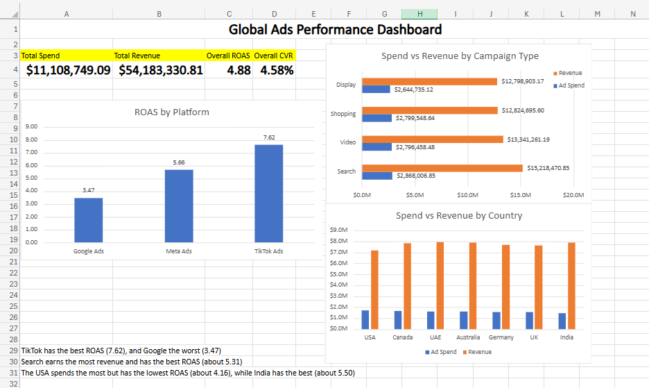

# marketing-analytics-portfolio
Marketing MBA student (Finance minor) building analytics skills for marketing analyst roles.

## Project 1: Global Ads Performance Analysis
1,800 simulated campaigns across Google, Meta and TikTok, analysed in Excel.

### Findings

- TikTok has the best ROAS (7.62) and Google the worst (3.47).
- 48% of TikTok campaigns are Strong (ROAS of at least 5 and conversion rate of at least 4%), against 26% for Google.
- Google takes about 57% of total spend but only about 41% of total revenue.
- The USA spends the most and has the lowest ROAS (about 4.16); India has the best (about 5.50).
- Search campaigns have the best ROAS (about 5.31) and earn the most revenue ($15.2M).

[Full project summary (PDF)](Ads_Project_Summary.pdf)
